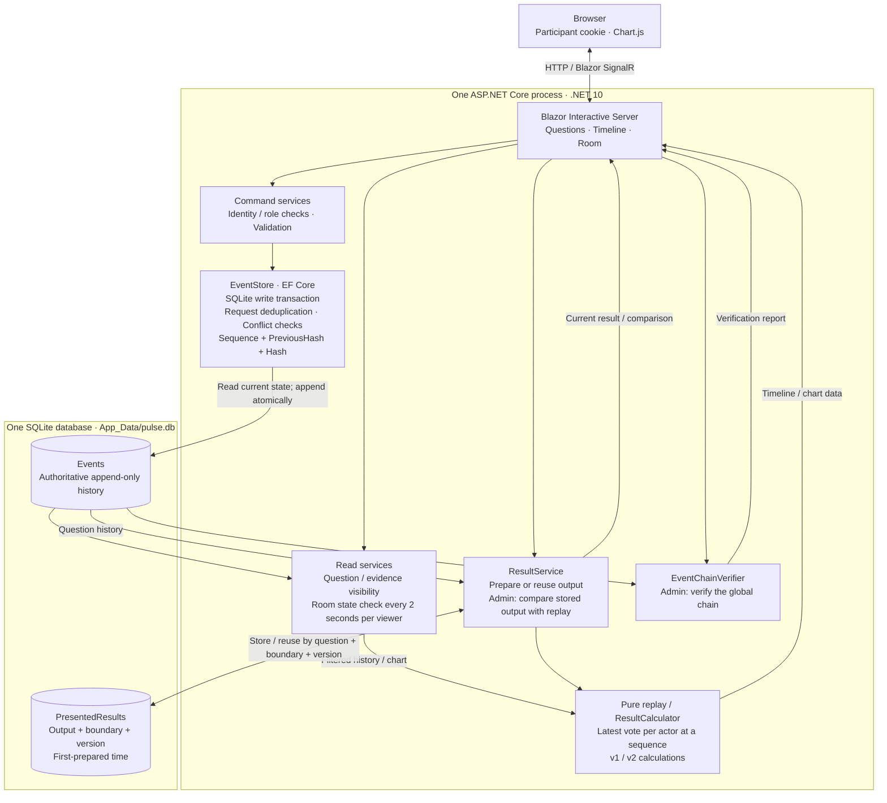

# PULSE architecture

Arrows show calls or data flow, not separate network services. Room polling runs
on the server; SignalR transports UI changes. Timeline/chart reconstruction creates
no additional presentation records. Append-only rules are application guarantees;
the database owner can bypass them. See [DECISIONS.md](../DECISIONS.md) for limits.
